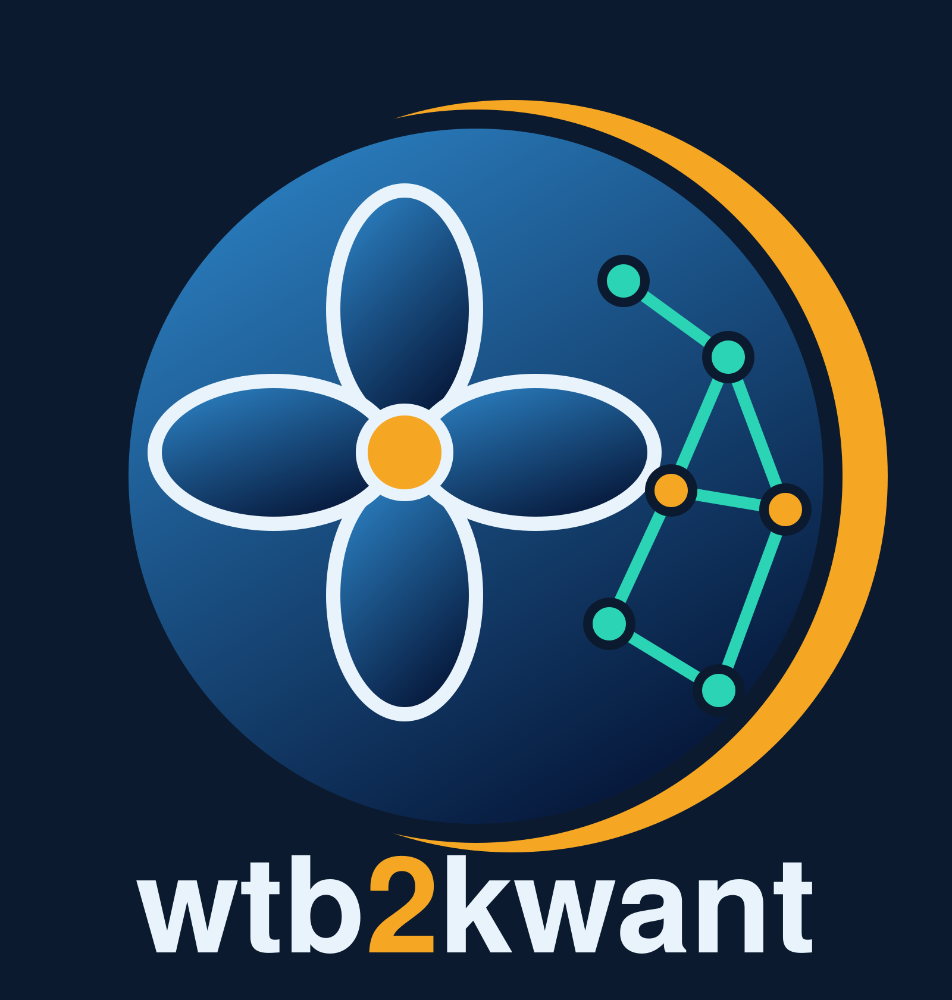
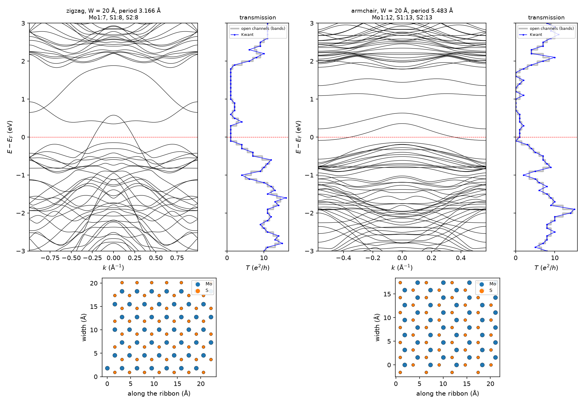
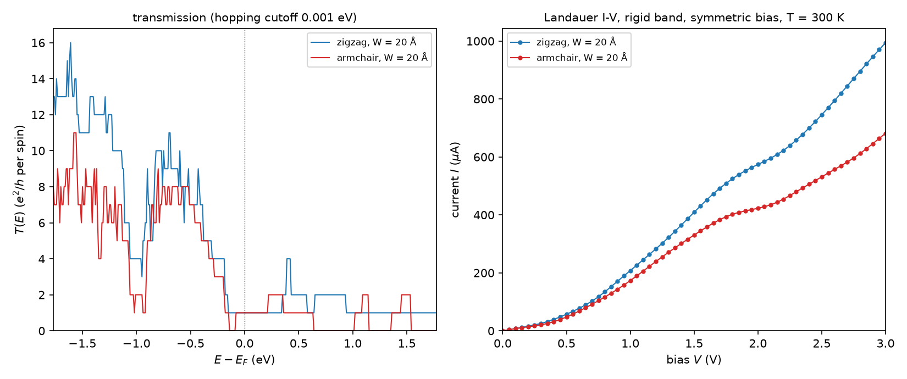

<p align="center">
  
</p>

# wtb2kwant

**wtb2kwant** converts tight-binding Hamiltonians in the
[WanTiBEXOS](https://github.com/ac-dias/wantibexos) format into a
self-contained **[Kwant](https://kwant-project.org) Python script**. You can then use
that script to compute band structures and quantum transport in nanoribbons and other
nanostructures cut from the original crystal.

It accepts both kinds of WanTiBEXOS Hamiltonians:

- **orthogonal** Wannier90-type Hamiltonians (`tb_hr.dat`);
- **non-orthogonal** Hamiltonians with an overlap matrix S (`.ham`), written by the
  SIESTA, DFTB+, FHI-aims, CRYSTAL and YAeHMOP interfaces. Transport with these
  Hamiltonians is exact: the overlap is kept, not approximated.

```
tb_hr.dat + wannier90.wout        ─┐
                                   ├─►  wtb2kwant  ──►  kwant_model.py  ──►  ribbons, leads, G(E), ...
tb-*.ham  + basis or structure    ─┘
```

> **New in v0.2:** support for non-orthogonal Hamiltonians (`.ham` + overlap S), with
> exact transport and generalized band structures. See
> [Non-orthogonal Hamiltonians](#non-orthogonal-hamiltonians) below and Section 4.3 of the
> [manual](manual/wtb2kwant_manual.pdf).

The generated script embeds the converted parameters (lattice, orbital positions,
on-site blocks and hopping blocks). It needs only `numpy`, `kwant` and `matplotlib`,
so you can copy it, share it and modify it freely.

## Features

- Reads the WanTiBEXOS **Wannier90-type** Hamiltonian (`tb_hr.dat`, produced by
  `param_gen_vasp`). The spin types are NP, SP and SOC.
- Reads the WanTiBEXOS **non-orthogonal** Hamiltonians (`.ham` with overlap matrix S) from
  the SIESTA, DFTB+, FHI-aims, CRYSTAL and YAeHMOP interfaces.
  - Orbital positions come from the `.basis` file (SIESTA, YAeHMOP) or from the crystal
    structure (POSCAR, `geometry.in`, DFTB+ `.gen`, CRYSTAL output, or ASE formats) plus
    `--norb`.
  - Transport is **exact** through the energy-dependent substitution H′ = H − E(S − 1).
  - Bands come from the generalized problem H(k)c = E S(k)c.
  - Löwdin orthogonalization is available as an experimental option.
- Reads the **Wannier centres, atoms and lattice** directly from `wannier90.wout`, so you
  don't have to rerun Wannier90. For spin-polarized runs it takes two `.wout` files
  (up and down).
- Assigns each Wannier function to its nearest atom. Kwant sites are atoms with
  `norbs` orbitals each. Alternatively, `--sites centres` makes one site per Wannier
  function.
- **Folds Wannier centres back into the home cell and corrects the R vectors
  accordingly**, so cuts in real space (ribbon edges) are physically correct.
- Divides by the Wannier90 degeneracy weights, symmetrizes, and applies an energy cutoff
  for small matrix elements.
- Handles **long-range Wannier hoppings**:
  - ribbon bands are computed from a Bloch Hamiltonian built with the primitive period,
    so they are not folded;
  - leads automatically use the smallest supercell that Kwant can finalize.
- The generated script provides `make_ribbon`, `ribbon_bands`, `make_two_terminal`,
  `conductance` (parallel), `channel_count`, `bulk_hk` and more, plus a ready-to-run
  example: zigzag and armchair ribbon bands with the Kwant transmission.

## Installation

The easiest way is the installer. It uses a conda environment named `kwant` and creates
it from conda-forge if it does not exist:

```bash
git clone https://github.com/ac-dias/wtb2kwant.git
cd wtb2kwant
./install.sh            # options: --env NAME, --no-editable, --dev, --python X.Y
conda activate kwant
```

The installer also writes launchers into `bin/` that call the environment's Python
directly. If you add that folder to your `PATH`, you can use the tool without activating
conda:

```bash
export PATH="$PWD/bin:$PATH"                      # e.g. in ~/.bashrc
wtb2kwant tb_hr.dat --wout wannier90.wout -o kwant_model.py
wtb2kwant-python kwant_model.py --help            # runs scripts with the env's Python
```

The launchers are machine-specific, so they are not versioned: `bin/` contains only its
own `.gitignore`.

Manual installation, in any environment that has Kwant:

```bash
conda create -n kwant -c conda-forge python=3.12 kwant numpy matplotlib
conda activate kwant
pip install -e .
```

## Quick start

```bash
# 1. Convert (in the folder of your Wannier90/WanTiBEXOS calculation)
wtb2kwant tb_hr.dat --wout wannier90.wout -o kwant_model.py

# 2. Built-in example: bands + Kwant transmission of zigzag and armchair
#    ribbons (20 Å wide) -> bands_ribbons.png + bands_ribbons_transmission.dat
python kwant_model.py
python kwant_model.py --no-transport                 # bands only (seconds)
python kwant_model.py --iv                           # Landauer I-V, 0-3 V (cheap Hamiltonian)
python kwant_model.py --iv --vrange -1 2 --nv 31     # I-V in a chosen bias range
python kwant_model.py --width-zz 30 --width-ac 25 --emin -2 --emax 2 --ne 81
python kwant_model.py --help
```

The transmission is parallelized over energies. By default it uses about one process
per physical core; set it with `--nproc`. For the MoS₂ example (61 energies,
11 orbitals per cell), each ribbon takes about 4 minutes on a 12-core workstation.
For quick scans, `--hop-cutoff 1e-3` drops small hoppings: it is about 4× faster but
less accurate.



### Current–voltage curves

`python kwant_model.py --iv` computes the transmission on a fine energy grid. It uses a
cheaper Hamiltonian, with hoppings below 10⁻³ eV dropped by default; change this with
`--hop-cutoff`. It then computes the Landauer current

I(V) = g_s (e/h) ∫ T(E) [f(E − E_F − V/2) − f(E − E_F + V/2)] dE

in the rigid-band approximation (T(E) computed at zero bias, symmetric bias, 300 K by
default). The default bias range is 0 to 3 V; choose another one with `--vrange VMIN VMAX`
(negative biases allowed). The outputs are `iv_ribbons.png`, `iv_ribbons_T.dat` and
`iv_ribbons_IV.dat`.



Transport, using the generated script as a module:

```python
from kwant_model import make_two_terminal, conductance

syst = make_two_terminal("zigzag", width=20.0, length=30.0).finalized()
T = conductance(syst, [-0.5, 0.0, 0.5])   # energies relative to E_F (eV)
```

Spin-polarized calculations:

```bash
wtb2kwant tb_hr.dat --wout wannier90.up.wout wannier90.dn.wout -o kwant_model.py
```

### Spin-resolved transport (SP and SOC)

For SP and SOC models the generated script also resolves the transmission and the current
by spin channel. The bands/transmission example and `--iv` draw the components and add them
as extra columns to the `.dat` files; `--iv` also writes `iv_ribbons_spin.png`. Turn this
off with `--no-spin`.

```python
from kwant_model import make_two_terminal, spin_conductance

syst = make_two_terminal("zigzag", width=20.0, length=30.0).finalized()
Ts = spin_conductance(syst, [-0.5, 0.0, 0.5])
# Ts["uu"], Ts["ud"], Ts["du"], Ts["dd"]: T[s', s], s = spin injected from lead 0,
# s' = spin collected in lead 1 ("ud" = down in, up out); Ts["total"]; Ts["mix"]
```

The components come from the NEGF formula T_s's = Tr[Γ₁^s' G Γ₀^s G†] with spin-projected
lead broadenings:

- **SP:** spin is conserved, so the result is exact: T↑ = `uu`, T↓ = `dd`, no spin flip.
- **SOC:** the lead modes already mix the two spins, so the split is not unique, and
  two projections are offered:
  - `--spin-projection sym` (default, {P, Γ}/2, the analogue of the symmetrized spin
    current): the components always add up to T, but the spin-flip terms can come out
    slightly negative.
  - `block` (P Γ P): the components are never negative, but they do not add up to T. The
    difference is reported as `mix`, and near band crossings with strong spin mixing it
    can be larger than T.
- **Wannier90 SOC:** the `tb_hr.dat` does not say which Wannier function carries which
  spin, so pass `--soc-spin-order blocks|interleaved` to the converter.

### Non-orthogonal Hamiltonians

The format is detected automatically. Kwant needs to know on which atom each orbital
sits, so give the orbital positions with `--basis` (SIESTA, YAeHMOP) or with
`--structure` plus the number of orbitals per spin of each species (`--norb`):

```bash
wtb2kwant tb-NP.ham --basis basis_set-NP.basis                 # SIESTA, YAeHMOP
wtb2kwant fhi_tb.ham --structure geometry.in --efermi -5.0096  # FHI-aims, one species
wtb2kwant hbn_sp_tb.ham --structure hbn_sp.out --norb B=14,N=14  # CRYSTAL
wtb2kwant dftb.ham --structure geo.gen --norb Mo=9,S=4          # DFTB+
```

The generated script and its options are the same as in the orthogonal case. In the
script, the on-site terms and hoppings are functions of the energy, and `conductance()`
passes it automatically. Some interfaces write E_F = 0 in the header, so give the Fermi
level with `--efermi`.

### Command-line options

| option | default | description |
|---|---|---|
| `input` | – | WanTiBEXOS Hamiltonian file (`tb_hr.dat` or `.ham`) |
| `--wout F [F]` | required | `wannier90.wout` (two files, up then down, for SP) |
| `--sites {atoms,centres}` | `atoms` | group Wannier functions by nearest atom, or one site per WF |
| `--soc-spin-order {blocks,interleaved}` | – | Wannier90 SOC: spin order of the WFs (needed for spin-resolved transport) |
| `--basis F` | – | `basis_set-*.basis` (non-orthogonal: SIESTA, YAeHMOP) |
| `--structure F` | – | crystal structure (non-orthogonal: DFTB+, FHI-aims, CRYSTAL, ...) |
| `--norb Sp=n,...` | – | orbitals per spin of each species (with `--structure`) |
| `--s-cutoff X` | `1e-6` | drop overlap elements with \|S\| < X |
| `--orthogonalize {none,lowdin}` | `none` | keep S (exact), or Löwdin (experimental, see below) |
| `--cutoff X` | `1e-5` | drop matrix elements with \|H\| < X (eV) |
| `--efermi X` | from file | override the Fermi energy (eV) |
| `-o FILE` | `kwant_model.py` | generated script |

## Validation

`tests/validate_mos2_np.py` runs a full validation on monolayer MoS₂ (Wannier90/VASP, 11
orbitals). The input data ship with the repository in `tests/data/mos2_np/`. The script
writes `tests/results/mos2_np/REPORT.md` and the figures. Summary:

- **Bulk bands vs `wannier90_band.dat`:** 0.02 meV error without cutoff, 0.13 meV with the
  default cutoff.
- **Hopping orientation inside Kwant:** 660 of 660 blocks are correct; the `wraparound`
  bands agree to 10⁻¹⁴ eV.
- **Ribbon bands:** the primitive-period Bloch Hamiltonian matches `kwant.physics.Bands`
  on the supercell to 10⁻¹⁴ eV.
- **Transmission of perfect ribbons:** an integer equal to the number of open channels.
- **Landauer current:** reproduces the analytic case T = 1, where I/V = 2e²/h.

`tests/validate_mos2_yaehmop_np.py` validates the **non-orthogonal** path with an
extended-Hückel MoS₂ model from YAeHMOP (17 orbitals, overlaps up to 0.44). It runs in
about 3 min and writes `tests/results/mos2_yaehmop_np/REPORT.md`:

- **Generalized bulk bands vs YAeHMOP:** 0.008 meV error in the window VBM−6…+4 eV; the gap
  is reproduced to 6 decimals.
- **Transmission with H − E(S − 1):** equal to the number of channels of the generalized
  ribbon bands at all energies, for both ribbons (difference exactly 0).
- **Löwdin (negative result, kept as a warning):**
  - exact in the bulk (it converges with the cutoff);
  - wrong by ~2 eV in nanoribbons. The Löwdin on-site energies absorb the bulk
    environment (Mo 5s: 0.2 → 24 eV), and at an edge the missing neighbours no longer
    compensate this.
  - For strongly non-orthogonal bases, keep S (the default).

`tests/validate_spin.py` validates the **SP and SOC** paths and the spin-resolved transport
(about 20 min; `tests/results/spin/REPORT.md`):

- **Graphene SP (FHI-aims):** the bands of each spin agree with the FHI-aims eigenvalues to
  8×10⁻⁶ eV, which is the precision of the FHI-aims output.
- **MoS₂ SOC (YAeHMOP):** 7×10⁻⁶ eV in VBM−6…+4 eV. The gap and the 165.011 meV SOC splitting
  at K are reproduced.
- **h-BN SP (CRYSTAL):** wtb2kwant reproduces the `.ham` (10⁻¹² eV), but the file itself is
  defective: it is not Hermitian and gives metallic bands. This is an issue of the CRYSTAL
  interface.
- **Synthetic ferromagnet** (MoS₂ with exchange H ∓ ΔS, exact test):
  T↑↑(E) = T_NP(E+Δ) and T↓↓(E) = T_NP(E−Δ) to 10⁻¹¹, the spin flip is 10⁻²⁴, and each
  spin component equals the spin channel count of the bands.
- **MoS₂ SOC ribbons:** T equals the channel count and the `sym` components add up to T
  exactly. The spin flip is ~10⁻³ T near E_F, but reaches ~0.1 T at a few valence-band
  crossings, where `block` components add up to as much as 2.2 T.

```bash
python -m pytest -q                        # quick regression tests (~2 min)
python tests/validate_mos2_np.py           # Wannier90 report (~13 min on 12 cores; --quick ~5 min)
python tests/validate_mos2_yaehmop_np.py   # non-orthogonal report (~3 min)
python tests/validate_spin.py              # SP/SOC report (~20 min)
```

## Documentation

The full manual (in English) is in [`manual/`](manual/): `manual/wtb2kwant_manual.pdf`.
It covers the input formats, the conventions, how the folding and supercells work, the
API of the generated script, and the validation.

## Current limitations and roadmap

- Supported: Wannier90-type and non-orthogonal WanTiBEXOS input; 2D crystals (ribbons).
- Spin-resolved transport with SOC is not unique, because the lead modes mix the spins;
  see the `--spin-projection` options above.
- The scissors operator is recorded in the generated script but not applied.
- Non-orthogonal bases: Kwant operators (local DOS, currents) are not yet adapted to S.
- Planned: nanotubes; 3D bulk crystals and slabs.

### Pending tests

**Inputs and band structures**

- **Wannier90 SP:** no data set yet (two `.wout` files, up and down).
- **Wannier90 SOC:** no data set yet, needed to test `--soc-spin-order` on real data.
- **CRYSTAL SP:** a correct `.ham` is needed; the current h-BN file is not Hermitian.
- **SIESTA and DFTB+ inputs:** validate with 2D test cases. The available SIESTA example
  (Sn₃O₄) is 3D, and the DFTB+ example has no geometry file.
- **FHI-aims and CRYSTAL in pytest:** add reduced data sets to the automated tests (today
  `validate_spin.py` reads them from outside the repository).

**Transport separated by spin channel**

Already validated: an exact synthetic ferromagnet (T↑↑, T↓↓ = shifted NP transmission and
spin channel counts), graphene SP (T↑↑ = T↓↓ = T/2) and MoS₂ SOC ribbons (sum rule with
`sym`). Still pending:

- **Real magnetic SP system:** a ferromagnetic or half-metallic 2D crystal with reference
  data; so far only the synthetic exchange model is tested.
- **Independent check of the SP channels:** compare T↑ and T↓ with Kwant's own
  `conservation_law` route (`smatrix(...).transmission((1, s), (0, s))`).
- **SOC components against another NEGF code:** compare T↑↑, T↓↓ and the spin-flip terms
  T↑↓, T↓↑ with an independent spin-resolved calculation (e.g. TBtrans) on the same
  Hamiltonian.
- **Sensitivity of the SOC split:** with SOC the split into spin channels is not unique.
  Check how the components depend on the position of the lead interface (lead supercell,
  scattering-region length) and how `sym`, `block` and the spin-weighted channel counts
  compare.
- **Physical spin flip:** systems where the spin flip comes from scattering rather than
  from the lead modes, such as SOC ribbons with defects or disorder, or a Rashba term
  from an out-of-plane field.
- **Spin-resolved currents beyond the rigid band:** the spin I-V uses T(E) at zero bias;
  test it with a bias-dependent potential once that is implemented.

## License

wtb2kwant is released under the [MIT License](LICENSE).
