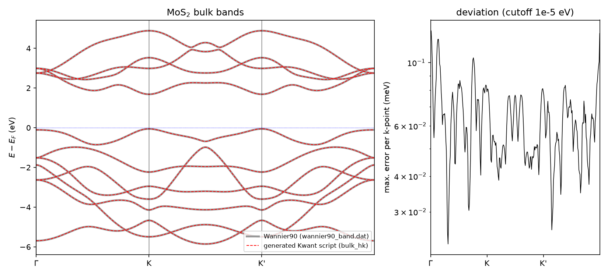
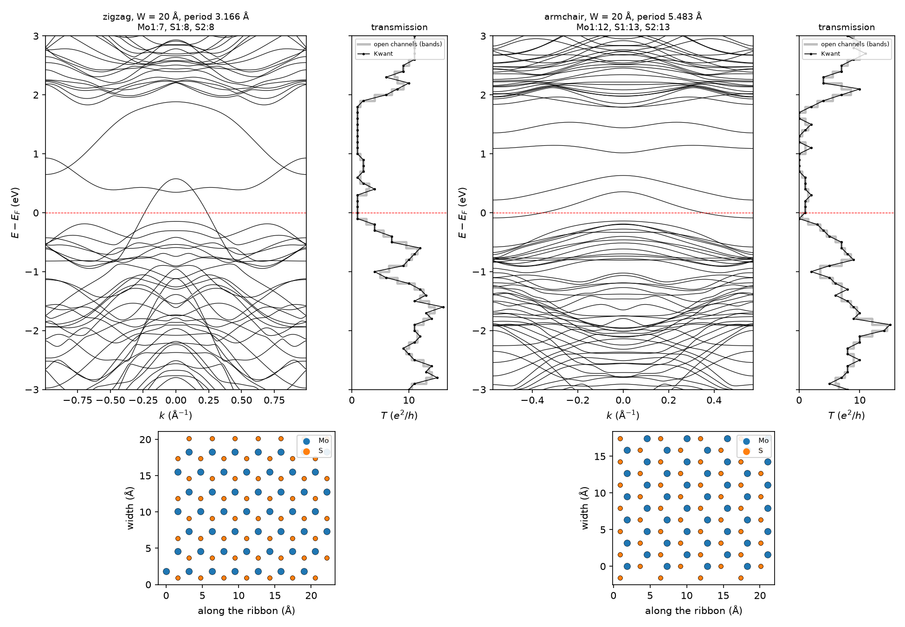
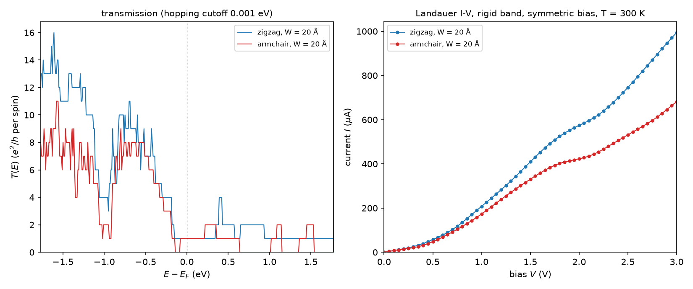

# Validação wtb2kwant: MoS2 monocamada (NP, Wannier90/VASP)

Gerado em 2026-11-24 16:51 por `tests/validate_mos2_np.py`.
Dados: `tests/data/mos2_np` (`tb_hr.dat` + `wannier90.wout`). Referência: `wannier90_band.dat`.

## 1. Leitura e folding dos centros

- Sistema NP, E_F = -0.9676 eV, tesoura = 0.5 eV, num_wann = 11, nrpts = 147

| WF | centro (.wout) (Å) | site | deslocamento n |
|---|---|---|---|
| wf1 | (1.583, -0.907, 8.000) | Mo1 (d = 0.006 Å) | (0, -1, 0) |
| wf2 | (1.583, -0.959, 8.000) | Mo1 (d = 0.045 Å) | (0, -1, 0) |
| wf3 | (1.583, -0.869, 8.000) | Mo1 (d = 0.045 Å) | (0, -1, 0) |
| wf4 | (1.583, -1.034, 8.000) | Mo1 (d = 0.121 Å) | (0, -1, 0) |
| wf5 | (1.583, -0.801, 8.000) | Mo1 (d = 0.113 Å) | (0, -1, 0) |
| wf6 | (-1.583, 0.922, 6.326) | S1 (d = 0.107 Å) | (-1, 0, 0) |
| wf7 | (-1.583, 0.925, 6.473) | S1 (d = 0.042 Å) | (-1, 0, 0) |
| wf8 | (-1.583, 0.895, 6.473) | S1 (d = 0.044 Å) | (-1, 0, 0) |
| wf9 | (-1.583, 0.922, 9.674) | S2 (d = 0.107 Å) | (-1, 0, 0) |
| wf10 | (-1.583, 0.925, 9.527) | S2 (d = 0.042 Å) | (-1, 0, 0) |
| wf11 | (-1.583, 0.895, 9.527) | S2 (d = 0.044 Å) | (-1, 0, 0) |

- dimensões periódicas: [0, 1]
- cutoff 0 eV: 15431/15431 elementos mantidos, 197 vetores R
- 11/11 WFs com centro fora da célula de origem (R corrigidos)

## 2. Bandas do bulk: modelo convertido × Wannier90

| cutoff (eV) | elementos mantidos | vetores R | erro máx. (meV) |
|---|---|---|---|
| 0 | 15431/15431 | 197 | 0.022 |
| 1e-05 | 13621/15431 | 197 | 0.130 |
| 3e-05 | 11053/15431 | 195 | 0.799 |
| 0.0001 | 7619/15431 | 153 | 3.750 |
| 0.001 | 3293/15431 | 63 | 31.048 |

- Script gerado (cutoff 1e-5), `bulk_hk`: erro máx. = 0.129 meV

## 3. Convenções no Kwant

- Orientação `syst[s(0), t(R)] == <s,0|H|t,R>` em um floco de raio 40 Å: 660/660 blocos corretos (de 660 no total).
- `kwant.wraparound` do builder bulk × `bulk_hk`: erro máx. = 1.0e-14 eV

## 4. Nanofitas (W = 20 Å)

| tipo | período | sites/célula | supercélula p/ leads (N) | Kwant Bands(N·T) × ribbon_hk desdobrado |
|---|---|---|---|---|
| zigzag | (1, 0) = 3.1655 Å | {'Mo1': 7, 'S1': 8, 'S2': 8} | 9 | 2.6e-14 eV |
| armchair | (1, 2) = 5.4829 Å | {'Mo1': 12, 'S1': 13, 'S2': 13} | 4 | 2.6e-14 eV |

## 5. Transporte (fita perfeita, W = 20 Å, região de espalhamento de 30 Å)

Numa fita perfeita a transmissão deve ser inteira e igual ao número de bandas que cruzam a energia com velocidade positiva.

| tipo | T(E−E_F = -0.5 eV) | T(E−E_F = +0.0 eV) | T(E−E_F = +0.2 eV) | T(E−E_F = +1.0 eV) | tempo |
|---|---|---|---|---|---|
| zigzag | 7.000 (bandas: 7) | 1.000 (bandas: 1) | 1.000 (bandas: 1) | 1.000 (bandas: 1) | 61 s |
| armchair | 7.000 (bandas: 7) | 1.000 (bandas: 1) | 1.000 (bandas: 1) | 0.000 (bandas: 0) | 86 s |

## 6. Curvas I-V (Landauer, banda rígida, hamiltoniano com cutoff 1e-3 eV)

I(V) = 2 (e/h) ∫ T(E) [f(E − E_F − V/2) − f(E − E_F + V/2)] dE, T = 300 K, T(E) com passo de 0,01 eV, calculado a bias zero.

- Verificação analítica (T = 1): I/V = 77.481 µA/V (esperado 2e²/h = 77.481 µA/V)
- Tempo total: 155 s

| V (V) | 0.1 | 0.5 | 1 | 1.5 | 2 | 2.5 | 3 |
|---|---|---|---|---|---|---|---|
| I zigzag (µA) | 7.81 | 57.18 | 207.81 | 409.12 | 574.05 | 745.67 | 994.33 |
| I armchair (µA) | 7.35 | 47.62 | 173.26 | 330.52 | 422.80 | 531.30 | 681.72 |

