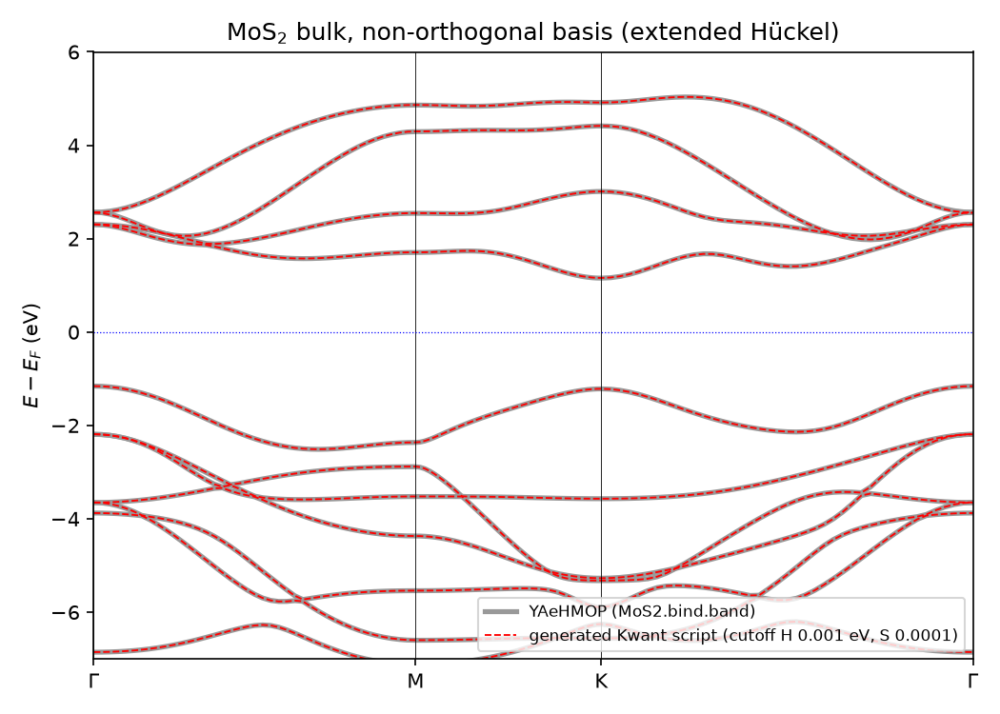
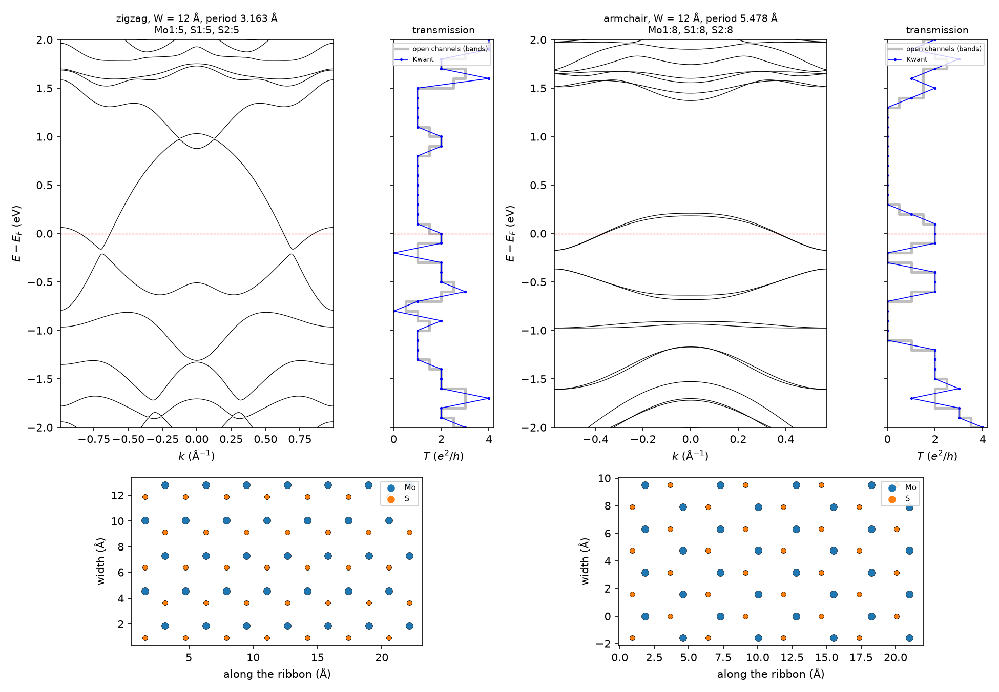
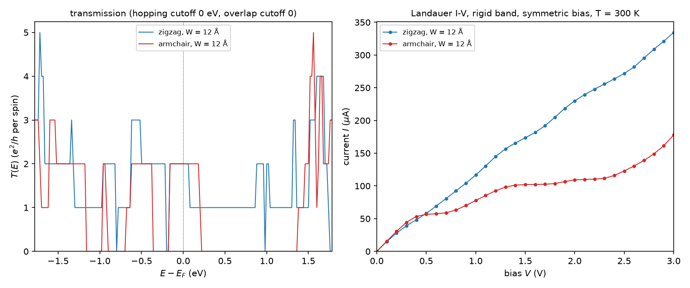
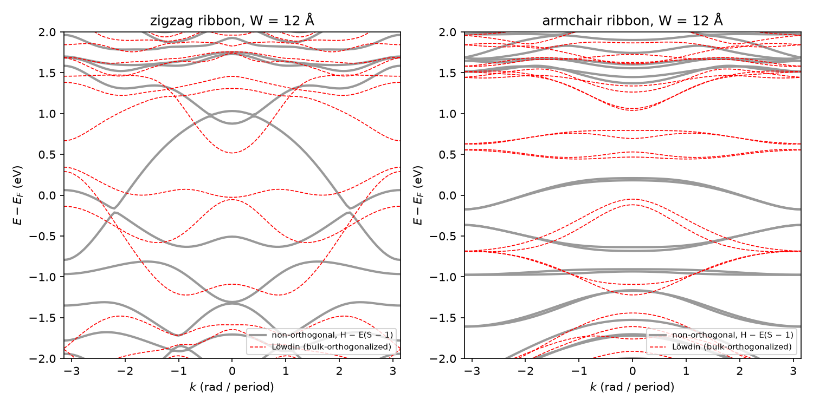

# Validação wtb2kwant: base não ortogonal, MoS2 (YAeHMOP, Hückel estendido)

Gerado em 2026-11-23 12:03 por `tests/validate_mos2_yaehmop_np.py`.
Dados: `tests/data/mos2_yaehmop_np` (`huckel-NP.dat` + `basis_set-NP`). Referência: `MoS2.bind.band` (YAeHMOP).
Base: Mo 5s5p4d (9 orbitais), S 3s3p (4 orbitais); 17 orbitais, S ≠ 1.

## 1. Bandas do bulk (problema generalizado) × YAeHMOP

Energias relativas ao VBM, como no script de comparação da interface. A interface do
YAeHMOP desloca o zero de energia por uma constante (7,83 eV), o que não altera as bandas
relativas.

| cutoff H (eV) | cutoff S | vetores R | erro máx. janela VBM−6…+4 eV (meV) | erro máx. todas (meV) | gap (eV) |
|---|---|---|---|---|---|
| 0 | 0 | 97 | 0.008 | 0.44 | 2.312981 |
| 1e-05 | 1e-06 | 55 | 0.095 | 30.16 | 2.313025 |
| 0.0001 | 1e-05 | 37 | 1.347 | 416.85 | 2.311694 |
| 0.001 | 0.0001 | 37 | 10.757 | 3122.27 | 2.316930 |

Referência YAeHMOP: gap = 2.312981 eV.

Modelo usado daqui em diante: cutoff H 0.001 eV, S 0.0001; E_F no meio do gap (-0.0526 eV no zero de energia do arquivo).
- base não ortogonal (S incluído); dimensões periódicas: [0, 1]
- cutoff H 0.001 eV: 2957/14675 elementos; cutoff S 0.0001: 2995/12635 elementos; 37 vetores R
- 0/3 átomos fora da célula de origem (R corrigidos)
- menor autovalor de S(k) (malha 24x24): 2.129e-02

- Script gerado, `bulk_bands` × YAeHMOP: janela 10.76 meV, todas 3125.6 meV

## 2. Termos dependentes da energia no Kwant

- `syst[s(0), t(R)](E) == (H - E_F S) - E S` para 3 energias: 285/285 corretos.

## 3. Nanofitas (W = 12 Å): bandas generalizadas e transmissão

A transmissão usa H' = H − E(S − 1) (exata). Numa fita perfeita ela deve ser igual ao
número de bandas do problema generalizado que cruzam E com velocidade positiva.

| tipo | N (supercélula do lead) | sites/célula | max \|T − canais\| (41 energias) |
|---|---|---|---|
| zigzag | 4 | {'Mo1': 5, 'S1': 5, 'S2': 5} | 0.0e+00 |
| armchair | 2 | {'Mo1': 8, 'S1': 8, 'S2': 8} | 0.0e+00 |

Tempo (bandas + transmissão): 164 s

## 4. Curvas I-V (Landauer, banda rígida, 300 K)

T(E) com passo de 0,02 eV, modelo já com o alcance curto (sem cutoff extra); tempo 11 s.

| V (V) | 0.5 | 1 | 1.5 | 2 | 2.5 | 3 |
|---|---|---|---|---|---|---|
| I zigzag (µA) | 58.00 | 116.61 | 173.53 | 230.02 | 271.70 | 334.52 |
| I armchair (µA) | 56.62 | 77.72 | 102.09 | 109.18 | 122.83 | 177.81 |

## 5. Ortogonalização de Löwdin × base não ortogonal

- ortogonalização de Löwdin: malha 31x31, 379 vetores R, 20077 elementos; cond(S) <= 1.7e+02; erro máx. das bandas fora da malha (40 pontos k aleatórios): 5.50e-02 eV
- elementos: 5952 (H + S, não ortogonal) → 20077 (H de Löwdin), mesmo cutoff de 0.001 eV

| fita | N (lead), não ortogonal | N (lead), Löwdin | desvio máx. das bandas Löwdin, \|E − E_F\| < 2 eV (meV) |
|---|---|---|---|
| zigzag | 4 | 12 | 2174.4 |
| armchair | 2 | 7 | 2165.6 |

Tempo: 8 s.

**Convergência no bulk** (modelo com cutoff H 1e-5, S 1e-6): o erro de Löwdin fora da malha
cai com o cutoff, o que confirma a implementação.

| cutoff Löwdin (eV) | vetores R | erro máx. das bandas do bulk (meV) |
|---|---|---|
| 0.001 | 381 | 56.30 |
| 0.0001 | 593 | 6.63 |
| 1e-05 | 865 | 0.97 |

**Por que as fitas diferem tanto: renormalização on-site.** As sobreposições do Hückel
estendido chegam a |S| = 0.44 entre vizinhos. Os termos on-site de Löwdin absorvem
o ambiente do bulk:

| orbital | on-site original (eV) | on-site Löwdin (eV) |
|---|---|---|
| Mo1 o1(l0,m0) | 0.22 | 24.12 |
| Mo1 o2(l1,m1) | 2.64 | 50.02 |
| Mo1 o3(l1,m-1) | 2.64 | 49.92 |
| Mo1 o4(l1,m0) | 2.64 | 26.44 |
| Mo1 o5(l2,m2) | -2.35 | -0.14 |
| Mo1 o6(l2,m0) | -2.35 | -0.80 |
| Mo1 o7(l2,m-2) | -2.35 | -0.14 |
| Mo1 o8(l2,m1) | -2.35 | 0.17 |
| Mo1 o9(l2,m-1) | -2.35 | 0.17 |
| S1 o10(l0,m0) | -12.05 | -7.74 |
| S1 o11(l1,m1) | -4.06 | 1.08 |
| S1 o12(l1,m-1) | -4.06 | 1.06 |
| S1 o13(l1,m0) | -4.06 | -1.66 |
| S2 o14(l0,m0) | -12.05 | -7.74 |
| S2 o15(l1,m1) | -4.06 | 1.08 |
| S2 o16(l1,m-1) | -4.06 | 1.07 |
| S2 o17(l1,m0) | -4.06 | -1.66 |

No bulk essa renormalização é compensada pelos hoppings de Löwdin com os vizinhos. Numa
borda os vizinhos faltam e a compensação não acontece: os átomos de borda (e, numa fita
de 12 Å, quase todos os átomos estão perto de uma borda) ficam com níveis errados por eV.
Conclusão: para bases muito não ortogonais (Hückel estendido, bases difusas) Löwdin serve
para o bulk, mas não para nanoestruturas; o padrão do wtb2kwant (manter S e usar
H − E(S − 1)) é exato.

Tempo total da validação: 190 s.
