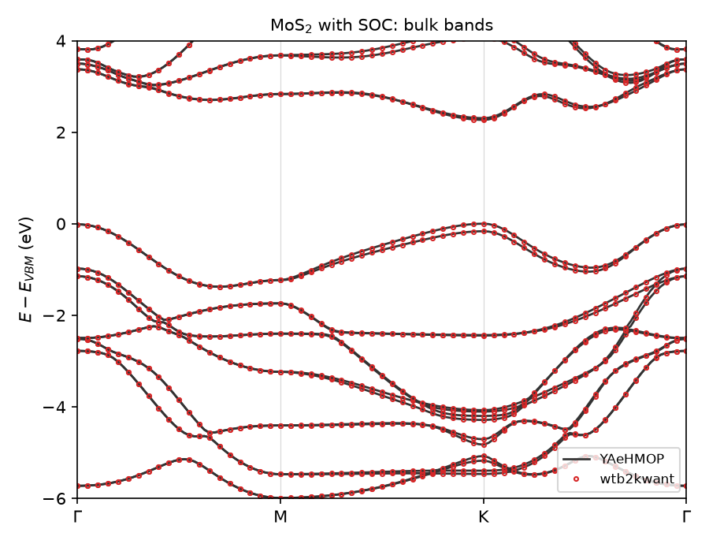
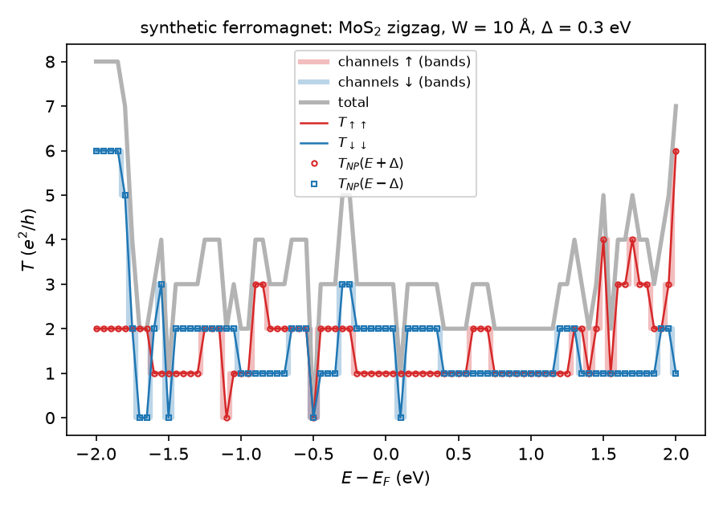
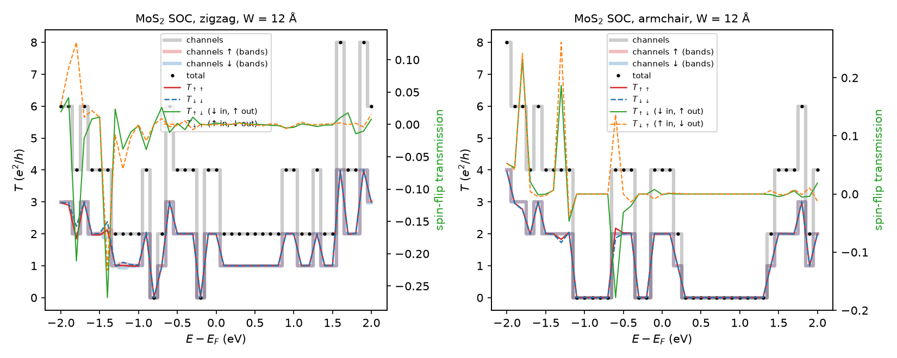

# Validação wtb2kwant: sistemas com spin (SP e SOC)

Gerado em 2026-11-24 17:05 por `tests/validate_spin.py`.

Convenção do transporte resolvido em spin: T_σ'σ, com σ = spin injetado no lead 0 e
σ' = spin coletado no lead 1 (`uu`, `ud` = entra ↓ e sai ↑, `du`, `dd`). Calculado por
NEGF, T_σ'σ = Tr[Γ₁^σ' G₁₀ Γ₀^σ G₁₀†], com Γ^σ = {P_σ, Γ}/2 (projeção `sym`, padrão) ou
Γ^σ = P_σ Γ P_σ (`block`). Com spin conservado (SP) as duas são idênticas e exatas.

## 1. Grafeno SP (FHI-aims): bandas contra o DFT

Dados: `$WTB2KWANT_INTERFACES_TEST/aims/graphene-sp` (`fhi_tb.ham` + `geometry.in`); referência: `band1xxx.out` (spin ↑) e `band2xxx.out` (spin ↓) do FHI-aims, nos 81 pontos k da malha 9×9 usada pela interface.
Modelo: 56 spin-orbitais, 2 sites com 28 orbitais (base tier do FHI-aims, 28 por spin e por átomo); acoplamento ↑↓ máximo em H e S: 0.0e+00.

| spin | bandas DFT | desvio constante (= E_F) | máx. desvio, E−E_F ∈ [−20, 10] eV | máx. desvio, todas |
|---|---|---|---|---|
| ↑ | 17 | -5.00957 eV | 8.3e-06 eV | 1.0e-04 eV |
| ↓ | 17 | -5.00957 eV | 8.3e-06 eV | 1.0e-04 eV |

- ↑ e ↓ idênticos (grafeno não magnético): máx. |E↑ − E↓| = 0.0e+00 eV.
- Os `band*.out` do FHI-aims dão energias relativas ao E_F (−5,0096 eV), daí o desvio constante. O FHI-aims escreve 5 casas decimais, o que limita a comparação a ~1e-5 eV.
- Ponto de Dirac em K = (1/3, 1/3): gap 3.6e-04 eV, a 0.000 eV de E_F.

Tempo: 2 s.

## 2. h-BN SP (CRYSTAL)

Dados: `$WTB2KWANT_INTERFACES_TEST/crystal/sp` (`hbn_sp_tb.ham` + `hbn_sp.out`, `--norb B=14,N=14`). O `.out` do CRYSTAL tem só as matrizes de Fock em espaço real, sem bandas, então não há referência DFT direta.

- wtb2kwant × soma de Fourier direta do `.ham` (23 pontos k): 3.2e-12 eV. O leitor, o folding e o agrupamento por site reproduzem o arquivo.
- ↑ e ↓ idênticos (sistema não magnético, acoplamento ↑↓ = 0e+00): 6.8e-13 eV.
- **O próprio `.ham` está com defeito**: H(R) ≠ H(−R)† (máx. 37.2 eV; em S, 0.82), 1 vetor R sem o parceiro −R. As bandas saem metálicas (com 6 bandas ocupadas por spin, VBM em -0.76 eV e CBM em -2.75 eV relativos a E_F), mas o h-BN é isolante com gap de ~6 eV. O problema está na interface do CRYSTAL (`crystal2wtb`), não no wtb2kwant: este conjunto não serve como referência até a interface ser corrigida.

Tempo: 1 s.

## 3. MoS2 SOC (YAeHMOP): bandas contra o YAeHMOP

Dados: `tests/data/mos2_yaehmop_soc` (`huckel-SOC.dat` reduzido + `basis_set-SOC`); referência: `MoS2.bind.band` (YAeHMOP com SOC, 121 pontos k em Γ-M-K-Γ). 34 spin-orbitais; acoplamento ↑↓ máximo 0.10 eV (o SOC mistura os spins).

| grandeza | wtb2kwant | YAeHMOP | diferença |
|---|---|---|---|
| bandas em VBM−6 … VBM+4 eV | | | 7.2e-06 eV |
| todas as bandas | | | 4.4e-04 eV |
| gap | 2.268108 eV | 2.268108 eV | 2.6e-08 eV |
| desdobramento SOC do topo da valência em K | 165.011 meV | 165.011 meV | 2.7e-05 meV |

Tempo: 1 s.

## 4. Transporte resolvido em spin

### 4a. SP magnético sintético (MoS2 NP do YAeHMOP + troca ±Δ)

Fita zigzag W = 10 Å (cutoff 1e-3 eV em H, 1e-4 em S), Δ = 0.3 eV, 81 energias. Resultado exato esperado: T↑↑(E) = T_NP(E + Δ), T↓↓(E) = T_NP(E − Δ), sem spin-flip.

- máx. |T↑↑(E) − T_NP(E+Δ)| = 8.3e-12; máx. |T↓↓(E) − T_NP(E−Δ)| = 5.9e-12
- spin-flip: máx. |T↑↓|, |T↓↑| = 2.6e-24; máx. |T − ΣT_σ'σ| = 1.8e-15
- Fita perfeita, canais por spin das bandas (`spin_channel_count`): máx. |T↑↑ − N↑| = 8.5e-12, máx. |T↓↓ − N↓| = 2.2e-12.
- Tempo: 45 s.

### 4b. Grafeno SP (FHI-aims): canais ↑ e ↓

Fita zigzag W = 8 Å (cutoff 1e-3 eV em H, 1e-4 em S).

| E − E_F (eV) | canais (bandas) | T | T↑↑ | T↓↓ | T↑↓ + T↓↑ |
|---|---|---|---|---|---|
| -1.0 | 2 | 2.000000 | 1.000000 | 1.000000 | 2.7e-29 |
| -0.2 | 2 | 2.000000 | 1.000000 | 1.000000 | -1.0e-28 |
| +0.3 | 2 | 2.000000 | 1.000000 | 1.000000 | -7.6e-28 |
| +1.0 | 10 | 10.000000 | 5.000000 | 5.000000 | 8.2e-24 |

T↑↑ = T↓↓ = T/2 = canais/2 (máx. desvio 5.8e-12). Tempo: 71 s.

### 4c. MoS2 SOC: componentes de spin e spin-flip

Fitas W = 12 Å (cutoff 1e-3 eV em H, 1e-4 em S), 41 energias em [−2, 2] eV.

| fita | máx. \|T − canais\| | `sym`: máx. \|T − ΣT_σ'σ\| | `sym`: máx. \|spin-flip\| / T | `sym`: mediana spin-flip / T | `block`: máx. \|T − ΣT_σ'σ\| / T |
|---|---|---|---|---|---|
| zigzag | 4.5e-12 | 3.4e-14 | 0.12 | 2.4e-03 | 0.34 |
| armchair | 8.8e-12 | 5.0e-14 | 0.11 | 4.1e-03 | 1.18 |

Energias com spin-flip (`sym`) acima de 2% de T:

| fita | E − E_F (eV) | T | T↑↑ | T↓↓ | T↑↓ | T↓↑ | `block`: ΣT_σ'σ |
|---|---|---|---|---|---|---|---|
| zigzag | -1.9 | 6.000 | 2.899 | 2.972 | +0.041 | +0.087 | 5.784 |
| zigzag | -1.8 | 4.000 | 1.844 | 2.240 | -0.211 | +0.127 | 4.814 |
| zigzag | -1.4 | 4.000 | 2.115 | 2.379 | -0.268 | -0.226 | 5.351 |
| zigzag | -1.3 | 2.000 | 1.017 | 0.976 | +0.024 | -0.016 | 1.989 |
| zigzag | -1.2 | 2.000 | 1.002 | 1.104 | -0.038 | -0.069 | 2.239 |
| armchair | -1.8 | 6.000 | 2.772 | 2.754 | +0.232 | +0.242 | 5.386 |
| armchair | -1.3 | 4.000 | 1.826 | 1.727 | +0.187 | +0.261 | 8.700 |
| armchair | -1.2 | 4.000 | 2.040 | 2.046 | -0.047 | -0.039 | 4.180 |
| armchair | -0.6 | 4.000 | 2.175 | 1.867 | -0.178 | +0.137 | 4.251 |

Fita perfeita: canais por spin das bandas (N_σ, ponderados pelo peso de spin ⟨P_σ⟩ de cada modo, por isso fracionários) × transmissão coletada em cada spin (T↑↑ + T↑↓ para ↑, `sym`):

| fita | máx. \|N↑ + N↓ − T\| | máx. \|N↑ − (T↑↑ + T↑↓)\| | mediana | máx. \|N↓ − (T↓↓ + T↓↑)\| | mediana |
|---|---|---|---|---|---|
| zigzag | 4.5e-12 | 0.363 | 5.9e-03 | 0.363 | 5.9e-03 |
| armchair | 8.8e-12 | 0.017 | 1.2e-04 | 0.017 | 1.2e-04 |

- Com SOC os dois números não precisam coincidir: N_σ é o spin médio dos modos do lead longe da interface, e T_σ'σ projeta o spin nos orbitais da interface. Quando o spin é quase conservado eles batem; nas energias de mistura forte a diferença mede a ambiguidade da divisão em canais de spin.
- Perto de E_F e na banda de condução o spin é quase conservado (spin-flip ≲ 10⁻³ T), como esperado para o MoS2, em que o SOC dominante (tipo Ising) conserva S_z.
- Na banda de valência há energias isoladas (cruzamentos de bandas em que o SOC mistura orbitais pares e ímpares) com mistura forte de spin. Ali a divisão de T em canais de spin deixa de ser única. Com `block` (P Γ P) os blocos ↑↓ de Γ ficam de fora e a soma das componentes pode passar de 2T (última coluna), o que não tem sentido físico. Com `sym` ({P, Γ}/2, o análogo da corrente de spin simetrizada {S_z, J}/2) a soma é sempre T e as componentes ficam limitadas, embora possam sair levemente negativas. Por isso `sym` é o padrão.
- Tempo: 569 s.

### 4d. Curvas I-V resolvidas em spin (MoS2 SOC, `run_iv`)

T(E) com passo de 0,02 eV, 300 K; tempo 591 s.

| fita | V (V) | I total (µA) | I↑↑ | I↓↓ | I↑↓ | I↓↑ | I total − ΣI_σ'σ |
|---|---|---|---|---|---|---|---|
| zigzag | 1 | 113.508 | 56.763 | 56.707 | 0.0510 | -0.0122 | 0.0000 |
| zigzag | 2 | 226.409 | 112.986 | 113.063 | 0.1416 | 0.2181 | 0.0000 |
| zigzag | 3 | 326.375 | 162.950 | 164.804 | -0.7955 | -0.5832 | 0.0000 |
| armchair | 1 | 76.170 | 38.249 | 38.122 | -0.1448 | -0.0563 | -0.0000 |
| armchair | 2 | 107.636 | 54.977 | 52.744 | -1.2971 | 1.2112 | -0.0000 |
| armchair | 3 | 176.803 | 89.742 | 87.348 | -1.4517 | 1.1645 | -0.0000 |

Tempo total: 1282 s.
