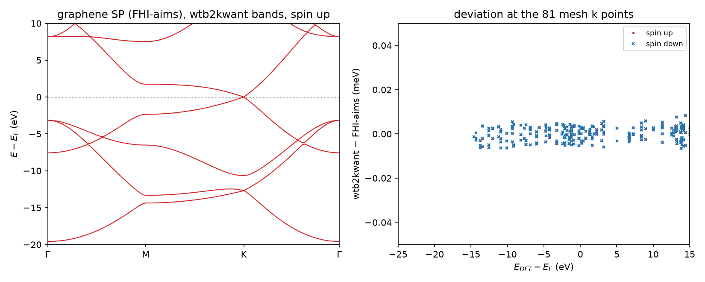
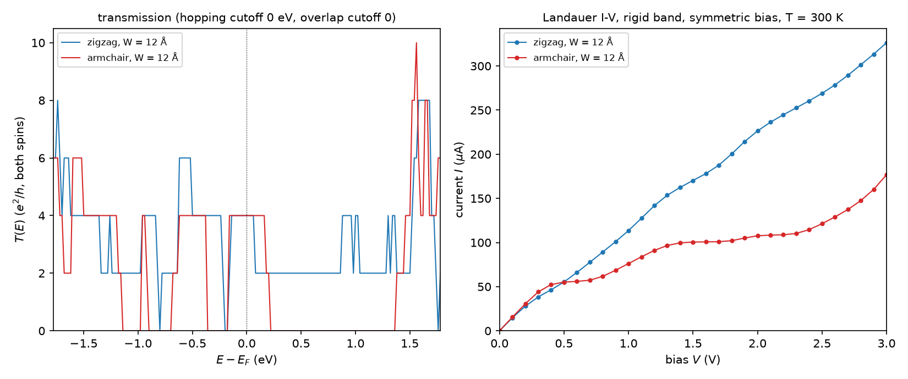
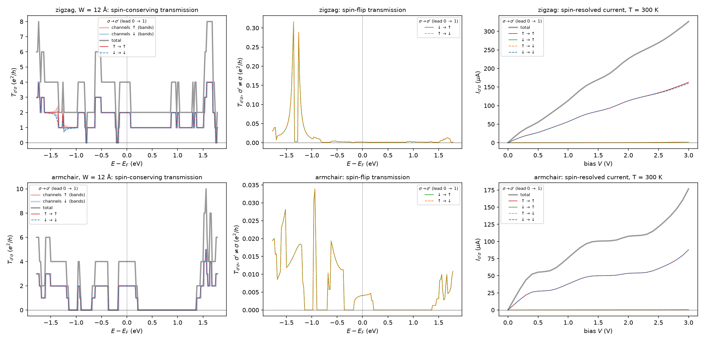

# Validação wtb2kwant: sistemas com spin (SP e SOC)

Gerado em 2026-11-24 18:52 por `tests/validate_spin.py`.

Convenção do transporte resolvido em spin: T_σ'σ, com σ = spin injetado no lead 0 e
σ' = spin coletado no lead 1 (`uu`, `ud` = entra ↓ e sai ↑, `du`, `dd`). Padrão (`modes`):
spin dos modos propagantes dos leads, T_σ'σ = Tr[t† W₁^σ' t W₀^σ], com t da matriz S e W^σ o
peso de spin dos modos. Para comparação: NEGF com Γ projetado nos orbitais da interface,
Γ^σ = {P_σ, Γ}/2 (`sym`) ou P_σ Γ P_σ (`block`). Com spin conservado (SP) as três coincidem.

## 1. Grafeno SP (FHI-aims): bandas contra o DFT

Dados: `$WTB2KWANT_INTERFACES_TEST/aims/graphene-sp` (`fhi_tb.ham` + `geometry.in`); referência: `band1xxx.out` (spin ↑) e `band2xxx.out` (spin ↓) do FHI-aims, nos 81 pontos k da malha 9×9 usada pela interface.
Modelo: 56 spin-orbitais, 2 sites com 28 orbitais (base tier do FHI-aims, 28 por spin e por átomo); acoplamento ↑↓ máximo em H e S: 0.0e+00.

| spin | bandas DFT | desvio constante (= E_F) | máx. desvio, E−E_F ∈ [−20, 10] eV | máx. desvio, todas |
|---|---|---|---|---|
| ↑ | 17 | -5.00957 eV | 8.3e-06 eV | 1.0e-04 eV |
| ↓ | 17 | -5.00957 eV | 8.3e-06 eV | 1.0e-04 eV |

- ↑ e ↓ idênticos (grafeno não magnético): máx. |E↑ − E↓| = 0.0e+00 eV.
- Os `band*.out` do FHI-aims dão energias relativas ao E_F (−5,0096 eV), daí o desvio constante. O FHI-aims escreve 5 casas decimais, o que limita a comparação a ~1e-5 eV.
- Ponto de Dirac em K = (1/3, 1/3): gap 3.6e-04 eV, a 0.000 eV de E_F.

Tempo: 2 s.

## 2. h-BN SP (CRYSTAL)

Dados: `$WTB2KWANT_INTERFACES_TEST/crystal/sp` (`hbn_sp_tb.ham` + `hbn_sp.out`, `--norb B=14,N=14`). O `.out` do CRYSTAL tem só as matrizes de Fock em espaço real, sem bandas, então não há referência DFT direta.

- wtb2kwant × soma de Fourier direta do `.ham` (23 pontos k): 3.2e-12 eV. O leitor, o folding e o agrupamento por site reproduzem o arquivo.
- ↑ e ↓ idênticos (sistema não magnético, acoplamento ↑↓ = 0e+00): 6.8e-13 eV.
- **O próprio `.ham` está com defeito**: H(R) ≠ H(−R)† (máx. 37.2 eV; em S, 0.82), 1 vetor R sem o parceiro −R. As bandas saem metálicas (com 6 bandas ocupadas por spin, VBM em -0.76 eV e CBM em -2.75 eV relativos a E_F), mas o h-BN é isolante com gap de ~6 eV. O problema está na interface do CRYSTAL (`crystal2wtb`), não no wtb2kwant: este conjunto não serve como referência até a interface ser corrigida.

Tempo: 1 s.

## 3. MoS2 SOC (YAeHMOP): bandas contra o YAeHMOP

Dados: `tests/data/mos2_yaehmop_soc` (`huckel-SOC.dat` reduzido + `basis_set-SOC`); referência: `MoS2.bind.band` (YAeHMOP com SOC, 121 pontos k em Γ-M-K-Γ). 34 spin-orbitais; acoplamento ↑↓ máximo 0.10 eV (o SOC mistura os spins).

| grandeza | wtb2kwant | YAeHMOP | diferença |
|---|---|---|---|
| bandas em VBM−6 … VBM+4 eV | | | 7.2e-06 eV |
| todas as bandas | | | 4.4e-04 eV |
| gap | 2.268108 eV | 2.268108 eV | 2.6e-08 eV |
| desdobramento SOC do topo da valência em K | 165.011 meV | 165.011 meV | 2.7e-05 meV |

Tempo: 1 s.

## 4. Transporte resolvido em spin

### 4a. SP magnético sintético (MoS2 NP do YAeHMOP + troca ±Δ)

Fita zigzag W = 10 Å (cutoff 1e-3 eV em H, 1e-4 em S), Δ = 0.3 eV, 81 energias. Resultado exato esperado: T↑↑(E) = T_NP(E + Δ), T↓↓(E) = T_NP(E − Δ), sem spin-flip.

- máx. |T↑↑(E) − T_NP(E+Δ)| = 2.5e-12; máx. |T↓↓(E) − T_NP(E−Δ)| = 4.3e-12
- spin-flip: máx. |T↑↓|, |T↓↑| = 1.0e-14; máx. |T − ΣT_σ'σ| = 1.8e-15
- Fita perfeita, canais por spin das bandas (`spin_channel_count`): máx. |T↑↑ − N↑| = 2.6e-12, máx. |T↓↓ − N↓| = 7.3e-13.
- Tempo: 45 s.

### 4b. Grafeno SP (FHI-aims): canais ↑ e ↓

Fita zigzag W = 8 Å (cutoff 1e-3 eV em H, 1e-4 em S).

| E − E_F (eV) | canais (bandas) | T | T↑↑ | T↓↓ | T↑↓ + T↓↑ |
|---|---|---|---|---|---|
| -1.0 | 2 | 2.000000 | 1.000000 | 1.000000 | 4.0e-16 |
| -0.2 | 2 | 2.000000 | 1.000000 | 1.000000 | -1.1e-15 |
| +0.3 | 2 | 2.000000 | 1.000000 | 1.000000 | 1.7e-16 |
| +1.0 | 10 | 10.000000 | 5.000000 | 5.000000 | -8.4e-15 |

T↑↑ = T↓↓ = T/2 = canais/2 (máx. desvio 6.0e-12). Tempo: 72 s.

### 4c. MoS2 SOC: componentes de spin e spin-flip

Fitas W = 12 Å (cutoff 1e-3 eV em H, 1e-4 em S), 81 energias em [−2, 2] eV.

| fita | projeção | máx. \|T − ΣT_σ'σ\| | componente mínima | máx. spin-flip / T | mediana spin-flip / T | máx. \|N↑ − (T↑↑ + T↑↓)\| |
|---|---|---|---|---|---|---|
| zigzag | `modes` | 1.8e-15 | +0.001 | 0.224 | 1.5e-03 | 0.002 |
| zigzag | `sym` | 4.4e-14 | -0.385 | 0.267 | 2.3e-03 | 0.799 |
| zigzag | `block` | 1.4e+00 | +0.000 | 0.269 | 6.5e-05 | 0.301 |
| armchair | `modes` | 2.7e-15 | +0.001 | 0.016 | 6.0e-03 | 0.002 |
| armchair | `sym` | 7.5e-14 | -0.178 | 0.112 | 6.0e-03 | 0.089 |
| armchair | `block` | 4.7e+00 | +0.000 | 0.699 | 4.1e-04 | 1.506 |

T total = canais das bandas em todas as energias (máx. desvio 6.1e-12).

Energias com maior spin-flip em `modes`, comparadas com `sym`:

| fita | E − E_F (eV) | T | `modes`: ↑↑ / ↓↓ / ↑↓ / ↓↑ | `sym`: ↑↑ / ↓↓ / ↑↓ / ↓↑ | canais ↑ / ↓ |
|---|---|---|---|---|---|
| zigzag | -1.40 | 4.000 | 1.988 / 1.734 / 0.139 / 0.139 | 2.115 / 2.379 / -0.268 / -0.226 | 2.13 / 1.87 |
| zigzag | -1.35 | 4.000 | 1.809 / 1.459 / 0.366 / 0.366 | 1.567 / 1.365 / +0.437 / +0.631 | 2.17 / 1.83 |
| zigzag | -1.25 | 2.000 | 0.960 / 0.592 / 0.224 / 0.224 | 1.062 / 1.345 / -0.153 / -0.254 | 1.19 / 0.81 |
| zigzag | -1.20 | 2.000 | 0.992 / 0.853 / 0.077 / 0.077 | 1.002 / 1.104 / -0.038 / -0.069 | 1.07 / 0.93 |
| armchair | -2.00 | 8.000 | 3.953 / 3.954 / 0.047 / 0.047 | 3.952 / 3.943 / +0.052 / +0.053 | 4.00 / 4.00 |
| armchair | -1.65 | 2.000 | 0.990 / 0.991 / 0.009 / 0.009 | 0.988 / 0.987 / +0.013 / +0.012 | 1.00 / 1.00 |
| armchair | -0.95 | 4.000 | 1.968 / 1.966 / 0.033 / 0.033 | 1.945 / 2.059 / -0.034 / +0.030 | 2.00 / 2.00 |
| armchair | +1.90 | 2.000 | 0.989 / 0.990 / 0.010 / 0.010 | 0.994 / 0.999 / -0.004 / +0.011 | 1.00 / 1.00 |

- `modes` mede o spin nos modos propagantes dos leads, a mesma grandeza dos canais por spin (N_σ): as componentes são ≥ 0, somam exatamente T, e o T coletado em cada spin acompanha N_σ.
- Perto de E_F e na banda de condução o spin é quase conservado, como esperado para o MoS2, em que o SOC dominante (tipo Ising) conserva S_z. O spin-flip só cresce em cruzamentos de bandas da valência em que o SOC mistura orbitais pares e ímpares.
- `sym` e `block` projetam o spin nos orbitais da interface, onde Γ inclui o acoplamento lead-região, que mistura os spins. Nesses cruzamentos as componentes ficam instáveis: negativas com `sym` e com soma muito maior que T com `block` (colunas acima). Ficam só como comparação.
- Tempo: 826 s.

### 4d. Curvas I-V resolvidas em spin (MoS2 SOC, `run_iv`)

T(E) com passo de 0,02 eV, 300 K; tempo 551 s.

| fita | V (V) | I total (µA) | I↑↑ | I↓↓ | I↑↓ | I↓↑ | I total − ΣI_σ'σ |
|---|---|---|---|---|---|---|---|
| zigzag | 1 | 113.508 | 56.709 | 56.679 | 0.0600 | 0.0600 | -0.0000 |
| zigzag | 2 | 226.409 | 113.063 | 112.951 | 0.1978 | 0.1978 | -0.0000 |
| zigzag | 3 | 326.375 | 162.910 | 160.118 | 1.6730 | 1.6730 | -0.0000 |
| armchair | 1 | 76.170 | 37.968 | 37.968 | 0.1170 | 0.1170 | -0.0000 |
| armchair | 2 | 107.636 | 53.549 | 53.548 | 0.2696 | 0.2696 | -0.0000 |
| armchair | 3 | 176.803 | 87.908 | 87.906 | 0.4947 | 0.4947 | -0.0000 |

Tempo total: 1499 s.
